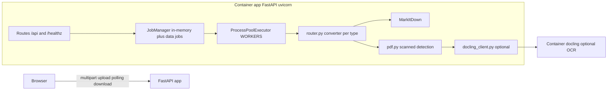
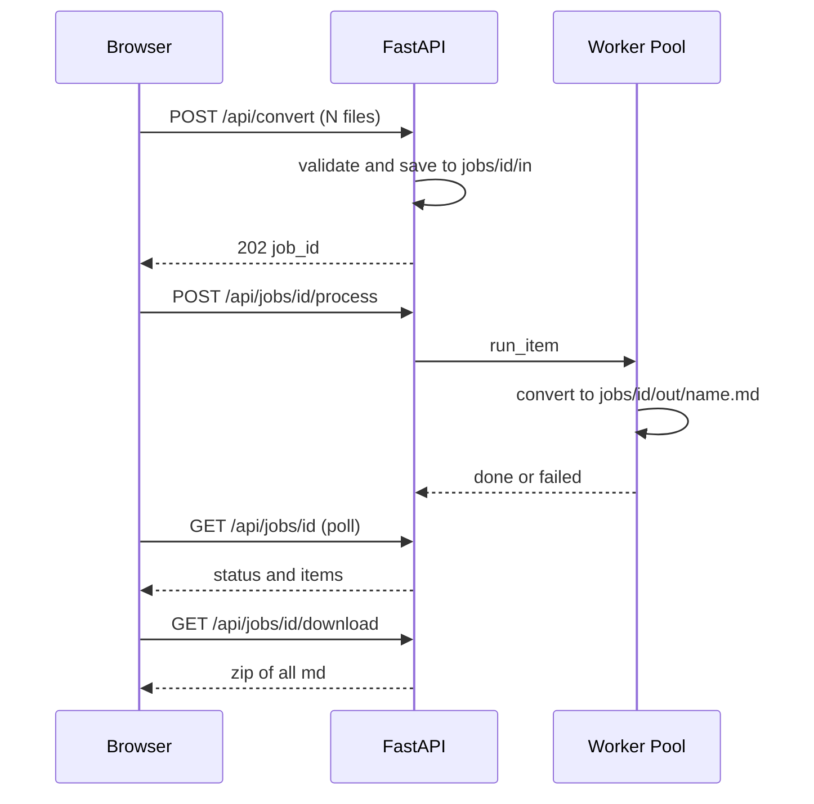

# markitdown-local

A lightweight, self-hosted web application that converts documents (PDF, Word, PowerPoint, Excel, HTML, CSV, JSON, XML, TXT, ZIP, images) to Markdown. No third-party upload, no per-file limits, open source (MIT).

## Features

- Drag-and-drop or multi-file upload
- Per-file status: queued, running, done, failed (with reason)
- Preview converted Markdown in the browser
- Download a single `.md` file or all results as a `.zip`
- Cancel (X) a queued file before it is processed
- Manual processing: "Proses" (single) and "Proses semua" (all)
- Scanned-PDF detection with optional OCR via a separate Docling service
- Stateless: no database, in-memory jobs with TTL cleanup
- No outbound network calls during conversion

## Architecture



### Data flow (one batch)



## Supported formats

| Level | Formats | Mechanism |
|---|---|---|
| Core | `.docx`, `.pptx`, `.xlsx`, `.html/.htm`, `.csv`, `.json`, `.xml`, `.txt/.md`, `.zip` | MarkItDown |
| PDF (digital) | `.pdf` with text layer | MarkItDown (pdfminer.six) |
| OCR (optional) | Scanned PDF, `.png/.jpg/.tiff/.bmp/.gif` | Docling (profile `ocr`) |
| Rejected | Everything else | Clear error: "format tidak didukung" |

Network-based MarkItDown features (URL/YouTube conversion) are disabled; only file uploads are accepted.

## Quick start (Docker Compose, recommended)

Requirements: Docker and Docker Compose.

```bash
git clone https://github.com/FTN-Dev/markitdown-local.git
cd markitdown-local
docker compose up -d
```

Open http://localhost:8090.

To stop:

```bash
docker compose down
```

### With OCR (scanned PDFs and images)

```bash
DOCLING_URL=http://docling:5001 docker compose --profile ocr up -d
```

This starts an additional `docling` container. OCR is optional and heavy (mem_limit 4g); leave it off if you only process digital documents.

## Native deployment (without Docker)

Requirements: Python 3.10+, and (optional) nginx for reverse proxy.

```bash
git clone https://github.com/FTN-Dev/markitdown-local.git
cd markitdown-local
python3 -m venv .venv
.venv/bin/pip install -r requirements.txt
```

Run directly:

```bash
DATA_DIR=/var/tmp/markitdown-local .venv/bin/uvicorn app.main:app --host 127.0.0.1 --port 8080 --workers 1
```

### systemd unit

Copy `deploy/markitdown-local.service` to `/etc/systemd/system/`, adjust paths, then:

```bash
sudo systemctl daemon-reload
sudo systemctl enable --now markitdown-local
```

### nginx reverse proxy

Example config is in `deploy/nginx.conf.example`. Key settings:

```nginx
client_max_body_size 100m;
proxy_read_timeout 300s;
proxy_pass http://127.0.0.1:8080;
```

### Apache reverse proxy

```apache
ProxyPreserveHost On
ProxyPass / http://127.0.0.1:8080/
ProxyPassReverse / http://127.0.0.1:8080/
LimitRequestBody 104857600
```

Enable required modules (`proxy`, `proxy_http`) and reload Apache.

## Configuration (environment variables)

| Variable | Default | Description |
|---|---|---|
| `HOST` | `0.0.0.0` | Bind address |
| `PORT` | `8080` | Bind port |
| `DATA_DIR` | `/data` | Working directory for jobs |
| `MAX_FILE_MB` | `50` | Max size per file |
| `MAX_FILES` | `50` | Max files per batch |
| `MAX_TOTAL_MB` | `200` | Max total upload size per batch |
| `WORKERS` | `2` | Number of conversion worker processes |
| `CONVERT_TIMEOUT_S` | `120` | Per-file conversion timeout |
| `JOB_TTL_MIN` | `60` | Job lifetime before automatic cleanup |
| `DOCLING_URL` | (empty) | Docling service URL for OCR |

## API

All endpoints are under `/api`. Responses are JSON unless noted.

| Method | Path | Description |
|---|---|---|
| `GET` | `/healthz` | Liveness check |
| `GET` | `/api/formats` | Supported extensions and OCR status |
| `POST` | `/api/convert` | Multipart `files[]`; returns `{job_id}` (202). Files are queued, not processed yet |
| `GET` | `/api/jobs/{id}` | Job status and item list |
| `POST` | `/api/jobs/{id}/process` | Process all queued items |
| `POST` | `/api/jobs/{id}/items/{item_id}/process` | Process one item |
| `DELETE` | `/api/jobs/{id}/items/{item_id}` | Cancel a queued/failed item |
| `GET` | `/api/jobs/{id}/files/{item_id}` | Download a single `.md` |
| `GET` | `/api/jobs/{id}/download` | Download all results as `.zip` |
| `DELETE` | `/api/jobs/{id}` | Delete a job early |
| `POST` | `/api/convert/sync` | Convert one file, return Markdown directly (for curl) |

Example:

```bash
curl -F "file=@report.docx" http://127.0.0.1:8080/api/convert/sync > report.md
```

## Security notes

- Default bind is `0.0.0.0` inside the container but published as `127.0.0.1:8090` on the host. Put a reverse proxy with authentication in front if you expose it.
- MarkItDown runs with the process privileges; only local file conversion is used (no URL conversion, no SSRF).
- Upload size, file count, total size, and per-file timeout are enforced.
- Files are stored with UUID names; original names are sanitized for display and download.
- Markdown preview is rendered as plain text (no HTML injection).
- Container runs as non-root, read-only filesystem with tmpfs for `/data` and `/tmp`.

## Cleanup and resource usage

- A janitor removes jobs older than `JOB_TTL_MIN` every 60 seconds (uploaded files, outputs, orphaned directories, stale `/tmp` files).
- On the host, schedule `docker system prune -f` and `docker builder prune -f` (for example daily via cron) to reclaim build cache and dangling images.
- Idle RAM is roughly 40 MB; image size is roughly 720 MB (dominated by onnxruntime/magika).

## License

MIT. See `LICENSE`.

## Third-party licenses

Dependencies are listed in `requirements.txt` and `pyproject.toml`. Their licenses (MarkItDown MIT, FastAPI MIT/BSD, etc.) must be respected. Add `THIRD_PARTY_LICENSES.md` before publishing a packaged release.
